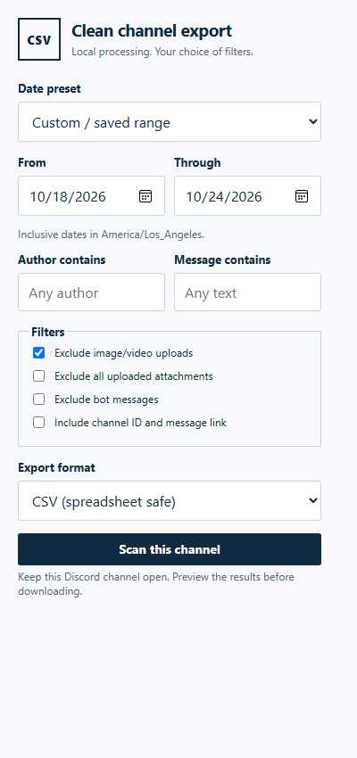

# Discord Clean CSV Exporter

A local-only Chrome extension for exporting Discord conversations to CSV or JSON. Choose an inclusive date range, filter messages, review a preview, and download the result.

No bot, account token, private API calls, analytics, or external processing. The extension reads rendered messages and scrolls through the channel history.



## Features

- Inclusive local dates, visible timezone, and Today / Last 7 days / Last 30 days presets.
- Case-insensitive author and message-text filters.
- Optional exclusion of uploaded images/videos, all attachments, and bot messages.
- CSV with spreadsheet formula neutralization and long numeric ID protection.
- JSON preserving original exported text and IDs, with scan metadata and exclusion counts.
- Optional channel IDs and direct message links.
- Pause/resume, cancellation, preview samples, exclusion counts, and explicit partial-export reasons.
- Local saved preferences; conversation records stay in tab memory.
- Navigation protection and partial recovery after scan errors.

## Install

1. Extract a release ZIP or clone this repository.
2. Open `chrome://extensions` and enable **Developer mode**.
3. Select **Load unpacked**, then choose the folder containing `manifest.json`.
4. Open a Discord text channel at `https://discord.com/channels/...`.

No build or package installation is required. After updating, reload both the extension and Discord tab.

## Export

1. Open the desired channel and select the extension icon.
2. Choose dates, filters, and CSV or JSON.
3. Select **Scan this channel**. Keep the same channel open and avoid manually scrolling during scanning.
4. Use the panel inside Discord to pause/resume or stop and preview a partial export.
5. Review the eligible count, exclusion reasons, and first five sample messages. Select **Download**.

Both dates are inclusive in the browser's local timezone, including daylight-saving transitions. Exported timestamps retain Discord's ISO values. A busy channel can take several minutes.

## Formats and filtering

Default columns: `timestamp`, `username`, `message`, `message_id`. Optional context adds `channel_id` and `message_url`.

CSV fields are quoted with quotes/newlines escaped. Potential spreadsheet formulas and long numeric IDs receive a leading apostrophe, deliberately changing those cell values to reduce formula execution and numeric rounding. Use JSON for original values. JSON also contains channel identity, dates, timezone, completion reason, partial flag, scanned count, and exclusion counts.

The media filter excludes the **whole message** when an attachment link has a recognized image/video extension. Ordinary links, previews, emoji, and stickers are not classified as uploaded media. Only message body text is exported; attachment contents, embeds, and quoted reply content are omitted. Messages without body text are excluded.

## Completeness and limitations

- This is a DOM exporter, not an authoritative archive. It captures only messages rendered for the signed-in user.
- Discord layout changes, localization, slow loading, inaccessible history, and browser throttling can affect scans. Live compatibility testing is necessary after Discord changes.
- The scanner attempts to establish the newest position, then scans backward with overlapping scroll steps and bounded waits. Reaching the date boundary or a recognized channel-start marker yields complete status only when initialization was verified. A stable rendered bottom is a heuristic, not server-side proof of completeness.
- Stalls, navigation, cancellation, and exceptions retain collected rows for a `-partial` download. Reloading/closing the tab discards records. Pause/resume works within the current scan only, not across browser restarts.
- Authors are display names, not immutable account IDs. Grouped messages inherit the nearest preceding observed author. Missing groups or changed markup can cause incorrect inference; unresolved authors remain blank and are counted. Bot detection uses visible badges.
- Filters are case-insensitive substrings. Counts assign each excluded message to its first matching reason; unknown-author counts are informational.
- Independent of Discord; not affiliated with or endorsed by Discord. Export only conversations you are allowed to retain and share.

## Permissions and privacy

`activeTab` and `scripting` allow injection when you select Scan. `storage` saves preferences locally. There is no persistent host access, background service, or extension network traffic. Scrolling can cause Discord itself to load history normally.

Conversation data is not written to extension storage. Downloads require selecting Download after preview. See [PRIVACY.md](PRIVACY.md).

## Development

Node.js 22+ is needed only for checks/tests. No third-party development dependencies are required.

```sh
npm run check
npm run package
```

In Windows PowerShell with script execution restricted, use `npm.cmd run check` and `npm.cmd run package`.

Packaging uses PowerShell and creates `dist/discord-clean-csv-exporter-2.0.0.zip`. GitHub Actions runs checks and uploads this ZIP as an artifact.

- `core.js`: extraction, immutable author resolution, filters, dates, serialization.
- `content.js`: scan lifecycle, navigation guards, progress, preview, downloads.
- `popup.*`: preferences and scan controls.
- `test/`: regression fixtures.
- `scripts/`: static checks and packaging.

Run the [manual checklist](docs/TESTING.md) before distributing a release. Automated fixtures do not establish current live Discord compatibility.

## License

MIT. See [LICENSE](LICENSE).

